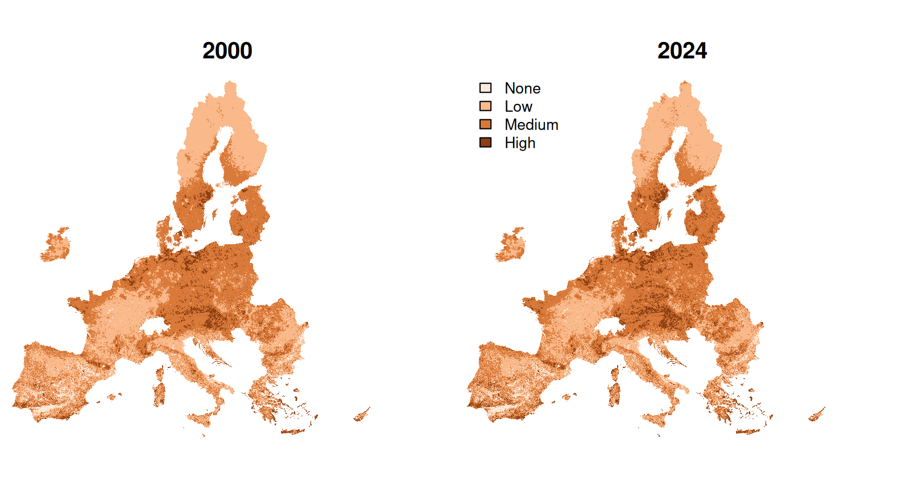
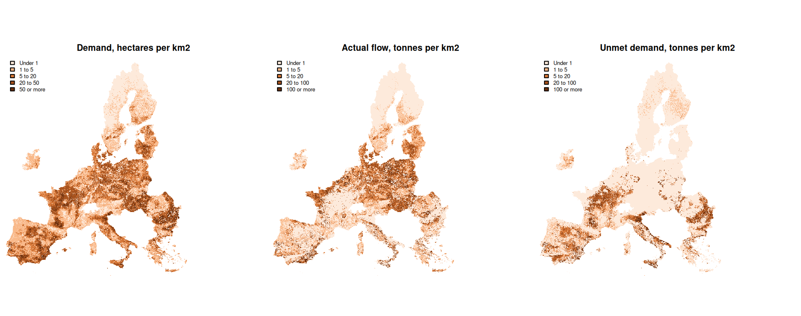
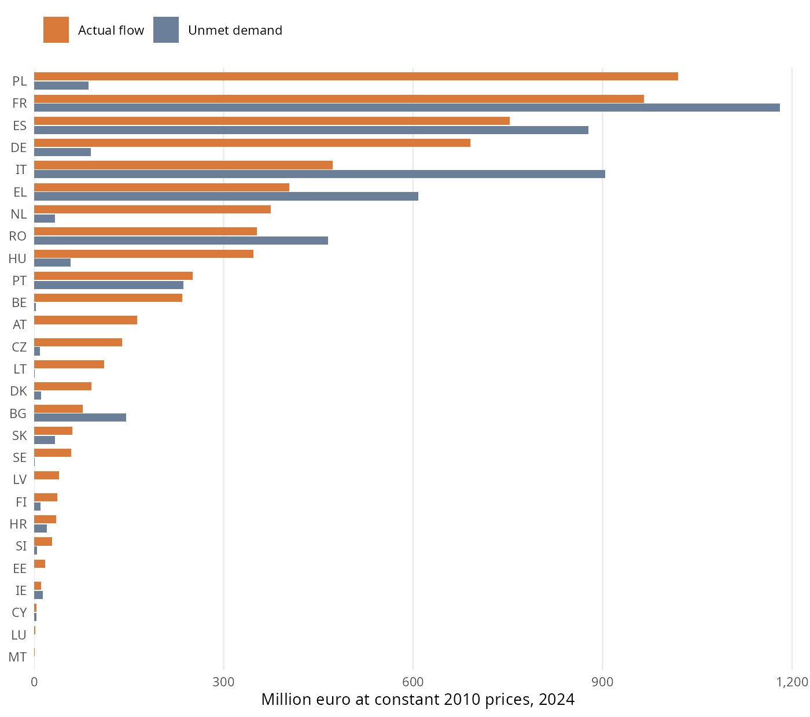

```{r}
#| label: setup
#| include: false

source("scripts/helpers_report.R", encoding = "UTF-8")

series <- read_report("eu_series")
value_series <- read_report("value_eu_series")
territory <- read_report("territory")
layers <- read_report("layer_summary")
by_class <- read_report("potential_by_class")
demand_class <- read_report("demand_by_class")
large_cells <- read_report("demand_large_cells")
uncovered <- read_report("uncovered_crop_area")
capri_eurostat <- read_report("capri_against_eurostat")
out_of_range <- read_report("factors_out_of_range")
no_figure <- read_report("no_eurostat_figure")
estimates <- read_report("estimates_summary")
production_year <- read_report("production_by_year")
eu_crop <- read_report("eu_by_crop")
country <- read_report("by_country")
value_country <- read_report("value_by_country")
value_crop <- read_report("value_by_crop")
value_gaps <- read_report("value_gaps")
deflators <- read_report("deflators")
published_value <- read_report("value_published_2006")
maps_tables <- read_report("maps_against_tables")
supply <- read_report("supply_by_ecosystem")
pilot <- read_report("pilot_luxembourg")
check_100m_totals <- readRDS("data/outputs/results/check_maps_100m_totals.rds")
check_100m_cells <- readRDS("data/outputs/results/check_maps_100m_cells.rds")
crops <- readr::read_csv("data/inputs/params/crop_dependency.csv", show_col_types = FALSE)
scores <- readr::read_csv("data/inputs/params/clc_pollination_scores.csv", show_col_types = FALSE)
crop_names <- setNames(crops$crop, crops$capri_code)

# Lookups for the numbers quoted in the text.
in_year <- function(table, y) filter(table, Year == y)
layer_mean <- function(name, y) layers$mean[layers$layer == name & layers$year == y]
land_class <- function(cl, y) by_class$land_mha[by_class$class == cl & by_class$year == y]
crop_value <- function(code, column = "flow_meur2010", y = 2024) value_crop[[column]][value_crop$crop == code & value_crop$year == y]
crop_row <- function(code, y) filter(eu_crop, crop == code, year == y)
country_row <- function(code, y = 2024) filter(country, geo == code, year == y)
value_row <- function(code, y = 2024) filter(value_country, geo == code, year == y)
capri_ha <- function(code, y) sum(uncovered$area_ha[uncovered$geo == code & uncovered$year == y])
estimate_row <- function(code, y) filter(estimates, group == code, year == y)
compare <- function(code, y) filter(capri_eurostat, crop == code, year == y)
factor_case <- function(g, cr, y) filter(out_of_range, geo == g, crop == cr, year == y)

demand_share <- function(cl, y) {
  d <- filter(demand_class, year == y)
  100 * sum(d$area_ha[d$class %in% cl]) / sum(d$area_ha)
}

met_2024 <- country |> filter(year == 2024) |> mutate(met = 100 * area_met_ha / area_ha)
met_of <- function(code) met_2024$met[met_2024$geo == code]

flow_2024 <- value_series$`Value of flow (M EUR 2010)`[value_series$Year == 2024]
fruit_share <- 100 * (crop_value("APPL") + crop_value("OFRU")) / flow_2024
rape_share <- 100 * crop_value("RAPE") / flow_2024

supply_2024 <- filter(supply, year == 2024)
supply_share <- function(name) 100 * supply_2024$flow_t[supply_2024$ecosystem == name] / sum(supply_2024$flow_t)

# Published flow value in 2006 and the part of the difference that comes from pome fruit.
published_flow <- 3100
here_flow_2006 <- sum(published_value$flow_meur)
pome <- filter(published_value, crop == "APPL")
pome_gap <- pome$flow_meur - pome$published_value * pome$published_contribution
pome_share <- 100 * pome_gap / (here_flow_2006 - published_flow)

ofru_2012 <- crop_row("OFRU", 2012)
ofru_2018 <- crop_row("OFRU", 2018)
demand_rise <- in_year(series, 2018)$`Demand (Mha)` - in_year(series, 2012)$`Demand (Mha)`

out_of_range_year <- out_of_range |>
  group_by(year) |>
  summarise(cases = n(), capri_t = sum(capri_t), eurostat_t = sum(eurostat_t), .groups = "drop") |>
  left_join(production_year, by = "year") |>
  mutate(share = 100 * eurostat_t / total_t)

sum_gaps <- check_100m_totals |> filter(statistic == "sum")
largest_sum_gap <- 100 * max(abs(sum_gaps$relative_gap))
cell_gap <- function(name) max(check_100m_cells$largest_cell_gap[check_100m_cells$quantity == name])

cy_mt_flow <- 100 * sum(filter(estimates, group %in% c("CY", "MT"), year == 2024)$flow_t) /
  (in_year(series, 2024)$`Actual flow (Mt)` * 1e6)
```

# Summary {.unnumbered}

We provide estimates of the crop pollination ecosystem service for the 27 Member States of the European Union in 2000, 2006,
2012, 2018 and 2024, following the accounting method of @vallecillo2018. In 2024, crops that depend on insect pollination
cover `r num(in_year(series, 2024)$"Demand (Mha)")` million hectares, and `r num(in_year(series, 2024)$"Met demand (%)", 0)`
percent of that area lies where the environment can support wild pollinators. The production attributable to the service is
`r num(in_year(series, 2024)$"Actual flow (Mt)")` million tonnes, against `r num(in_year(series, 2000)$"Actual flow (Mt)")`
million tonnes in 2000, and another `r num(in_year(series, 2024)$"Unmet demand (Mt)")` million tonnes depend on pollination but
grow outside that area. At constant 2010 prices, the actual flow is worth `r num(flow_2024 / 1000)` billion euro and the unmet
demand `r num(in_year(value_series, 2024)$"Value of unmet demand (M EUR 2010)" / 1000)` billion euro. Spatial crop data end in
2018, so the crop pattern of 2018 stands in for 2024.

# Introduction

Crop pollination is the fertilisation of crops by wild insects, which maintains or increases crop production. Ecosystem
accounting treats it as a service that ecosystems supply and farmers use. It therefore needs a measure of what the
environment can supply, a measure of where crops need it, and an estimate of what results when the two overlap
[@vallecillo2018].

This report describes how we estimated those three quantities and valued the result, why we took each decision along the way
and what the estimates show. The calculations are carried out by a series of scripts in the `scripts/` folder of this
repository, listed in @tbl-scripts in the order in which they run. Each step of the Methods section carries a footnote to its
script. The file `scripts/run_all.R` runs the whole series or any of its stages, and any single script can run again when only
one input changes. The tables and the 100 m maps can be retrieved from the Downloads page of this site.

```{r}
#| label: tbl-scripts
#| tbl-cap: "Scripts of the pipeline, in the order in which they run."

tibble(
  Script = c("01_prepare_nuts.R", "02_download_clc.R", "03_prepare_catalogue.R", "04_prepare_capri.R", "05_prepare_roads.R",
             "06_prepare_distance.R", "07_run_expert_model.R", "08_download_eurostat.R", "09_write_manifest.R",
             "10_prepare_zone_tables.R", "11_build_physical_accounts.R", "12_build_monetary_accounts.R", "13_write_maps_1km.R",
             "14_write_maps_100m.R", "15_check_maps_100m.R"),
  Purpose = c("Regional boundaries and a 1 km grid of regions", "Land cover at 100 m", "Insect activity index and bumblebee model at 1 km",
              "Crop area and yield at 1 km", "Major roads at 100 m", "Distance to semi-natural areas at 100 m",
              "Expert-based model at 100 m and its reduction to 1 km", "Crop production, production value and prices",
              "List of heavy inputs, and 100 m clips of Luxembourg", "Rasters added up by region",
              "Potential by region, demand, actual flow and unmet demand", "Value of the flow and of unmet demand",
              "Maps at 1 km and supply by ecosystem type", "Maps at 100 m", "Comparison of the 100 m maps with the 1 km maps")
) |>
  show_table()
```

::: {.callout-important}
## How to read the results for 2024

Spatial crop data end in 2018, so a decision was made to use the crop area and yield of 2018 to represent 2024. Data sources
with different methods and crop categories are not mixed within the series. Changes between 2018 and 2024 in demand, flow and
unmet demand therefore reflect pollination potential and national statistics, and they do not reflect any relocation of crops.
:::

::: {.callout-note}
## Sources of orientation

Two earlier implementations of this service provided orientation. The k.LAB project for this service [@klab2026] informed the
list of inputs, the table of land cover scores, the correspondence between major road categories and OpenStreetMap classes,
the grouping of Eurostat crops and the public catalogue of harmonised layers that some scripts read. The INCA plugin
[@inca2026] informed the sequence of preprocessing steps and the form of the activity index. The calculations in this report
are carried out by the code of this repository.
:::

# Methods

## Overview

The idea behind the accounts is that wild pollinators forage within a limited distance of the habitat that feeds and shelters
them, so a crop benefits from the service only where the surrounding environment can sustain them. The method expresses this
in four components [@vallecillo2018]. **Pollination potential** is a dimensionless indicator of how suitable a place is for wild
pollinators. It is the mean of an expert-based model of solitary bees and a species distribution model of bumblebees, and cells
with a potential of at least 0.2 form the **service providing area**. **Demand** is the area of crops that benefit from insect
pollination. **Actual flow** is the production attributable to pollination where demand and the service providing area overlap,
and **unmet demand** is the same quantity where they do not. Valuation then separates the share of the value of crop production
that is due to the service.

The analysis covers the European territory of the EU27, on the grid of the Corine Land Cover maps in the projection EPSG:3035.
Potential is modelled at 100 m and combined at 1 km, the resolution of the crop data, and the results are reported by region
and mapped at both resolutions.

## Territory and reporting regions

We used the NUTS 2024 boundaries [@gisco2024], the European classification of territorial units, to report on
`r territory$countries` countries (NUTS0), `r territory$nuts2` NUTS2 regions and `r territory$nuts3` NUTS3 regions. Each 1 km
cell was assigned to the NUTS3 region at its centre, and coastal and border cells whose centre falls outside every region took
the nearest region within 2 km, so that crop area on the coast is not lost.^[See `scripts/01_prepare_nuts.R`.] All tables are
built by adding up the NUTS3 regions, so the three levels match exactly. The Canary Islands, the Azores, Madeira and the
overseas regions fall outside the climate data and are left out. The resulting grid holds `r num(territory$land_mha)` million
hectares of land, of which `r num(territory$agro_mha)` million are agricultural in the land cover of 2018.

## The expert-based model

The expert-based model scores each 100 m cell from 0 to 1 for its capacity to support wild solitary bees, in the five steps
below.^[See `scripts/07_run_expert_model.R`, and `scripts/helpers_pollination.R` for the equations.]

### Land cover

The Corine accounting layers are the versions of the Corine Land Cover maps that the European Environment Agency prepares for
comparison over time, and they are the land cover data that the method prescribes. The public catalogue that accompanies the
k.LAB project [@klab2026] holds version 20 for the years up to 2018, whereas the Agency published version 21 for all five years
in September 2026 and marked version 20 as superseded [@eea2026clc]. We therefore considered two routes.^[See
`scripts/02_download_clc.R` and `scripts/03_prepare_catalogue.R`.]

Using the harmonised catalogue layer is the shorter route, and it offers a ready-made distance map. Rebuilding from primary
sources means downloading version 21 and recomputing the distance maps, and it gives one consistent product across the series,
including 2024. We ran the model on both routes for 2000 and 2018 and compared them at 1 km with the same climate, road and
bumblebee layers (@tbl-routes). The two agree closely on the mean and on the area served, although a few cells change
substantially. Since only the rebuilt route reaches 2024, a decision was made to use it as the baseline for all years. The comparison was run once, so the pipeline
does not repeat it, and -routes keeps its result.^[The route is available in `scripts/07_run_expert_model.R` with `routes <- "catalogue"`, which needs the
catalogue layers that `scripts/03_prepare_catalogue.R` retrieves.]

```{r}
#| label: tbl-routes
#| tbl-cap: "Pollination potential at 1 km from the rebuilt and the catalogue routes."

read_report("route_comparison") |>
  select(Year, Correlation, `Mean, rebuilt` = `Mean of rebuilt`, `Mean, catalogue` = `Mean of catalogue`,
         `Largest gap` = `Largest absolute gap`, `Service area, rebuilt (Mha)` = `Service area, rebuilt (Mha)`,
         `Service area, catalogue (Mha)` = `Service area, catalogue (Mha)`, `Class differs (%)`) |>
  show_table(digits = 3)
```

Each Corine class carries a score for floral availability $F$ and for nesting suitability $N$, on a scale from 0 to 1, which
@zulian2013 derived from the literature and an expert workshop. A cell takes the mean of the two, as @vallecillo2018 prescribe
in place of the product that @zulian2013 used.

$$
S = \frac{F + N}{2}
$$ {#eq-suitability}

The scores are those of Table S1 in the supplement to @zulian2013, shown in @tbl-scores in the appendix. That article refines them with
crop maps, a high resolution forest map, high nature value farmland, riparian areas and road sides, whereas the method of
@vallecillo2018 works from Corine alone, so a decision was made to use the values that the supplement offers for readers who rely on Corine
data only. These include an average for olive groves, which the supplement scores as 0.2 and 0.4 when intensive and 0.6 and 0.6 when
extensive. We took the table from the k.LAB project [@klab2026] and compared it with the supplement, and all
`r nrow(scores)` classes agree.

### Major roads

Major roads cannot provide food or nesting sites, so cells on a major road score zero. The method names a commercial road
network, TeleAtlas, which is proprietary. A decision was made to use OpenStreetMap [@osm2026] instead, taking motorways, trunk
roads and primary roads with their links, which correspond to the same categories, and rasterising them on the 100 m
grid.^[See `scripts/05_prepare_roads.R`.] As in the method, the road map is a single snapshot that applies to all years.

### Forest edges

Wild bees use forest margins more than forest interiors. Following @vallecillo2018, the outer ring of 100 m of each forest patch
keeps its score and the interior scores zero. Forest means the broad-leaved, coniferous and mixed forest classes 311, 312 and
313, and a forest cell belongs to the interior when all eight of its neighbours are also forest. The edge keeps the Corine score of its
class from Table S1. The supplement to @zulian2013 also holds separate scores for forest edges in its Table S3, which are 0.1 higher for both
floral availability and nesting suitability, and which it applies to an edge of 50 m.

### Distance to semi-natural areas

Pollinator richness and visits decline exponentially with isolation from natural habitat, at a mean rate of 0.00046 per metre
across 23 studies [@ricketts2008; @garibaldi2011]. The method applies this decay to the score, using the distance $d$ in metres
from each cell to the nearest semi-natural area.

$$
S_d = \exp\left(\ln(S) - 0.00046\, d\right) = S\, e^{-0.00046\, d}
$$ {#eq-decay}

The score is zero beyond 20 km. Semi-natural areas are the classes 311, 312, 313, 321, 322, 323, 324, 331 and 333. We computed
the Euclidean distance between cell centres for each of the five land cover maps.^[See `scripts/06_prepare_distance.R`.]

### Activity of insects

Habitat is of no use if it is too cold for insects to leave the nest. The activity index $A$ of @corbet1993, as adapted by
@zulian2013, expresses in percent how active insects are as a function of air temperature $T$ in degrees Celsius and solar
irradiance $R$ in watts per square metre, through the temperature of a black globe that simulates the body of an insect.

$$
A = -39.3 + 4.01\, T_b, \qquad T_b = -0.62 + 1.027\, T + 0.006\, R
$$ {#eq-activity}

The method names the Agri4Cast climate grid, whose access requires a sign-in that was not available. A decision was made to use
instead the ERA5 temperature [@hersbach2023] and the Copernicus radiation [@c3s2020] of the public catalogue, which reach 2025
and whose radiation is already expressed over day length. The method text refers to minimum temperature and its table of inputs
to mean temperature, and a decision was made to use mean temperature, which is the variable in @zulian2013. For each reporting
year we took the three years centred on it, with 2023 to 2025 for 2024, and computed the index for each month from April to
September. Each month was limited to the range from 0 to 100, as @zulian2013 do, before averaging the six months and
interpolating the result bilinearly to 1 km and then to 100 m.^[See `scripts/03_prepare_catalogue.R`.]

The expert-based model $E$ is the product of the decayed score and the index.

$$
E = S_d \, \frac{A}{100}
$$ {#eq-expert}

We ran the five steps over the whole grid in tiles, for each year, and reduced the result to 1 km with the mean of the land cells
of each kilometre. The reduction is what the following steps read, and the 100 m tiles remain outside the repository, listed with
their source, size and checksum in a manifest.^[See `scripts/09_write_manifest.R`.] To let a reader inspect the 100 m chain
with no download, the repository also holds the 100 m inputs of Luxembourg in 2018. Running the model on them reproduces the
full run with a largest difference of `r format(pilot$largest_gap, digits = 2)` in any kilometre inside the
country.^[See the function `run_pilot_luxembourg()` in `scripts/helpers_accounts.R`.]

## The bumblebee model

The second model estimates where bumblebees occur. The method fits a species distribution model to records of 47 species and
projects it to each period, which requires the fitted models. These are unavailable, so a decision was made to use the published
aggregated layer of @polce2018, which gives the mean probability of occurrence of the 47 species at 10 km. We interpolated it
bilinearly to 1 km, and land cells left without a value along the coast took the mean of their neighbours within 10
km.^[See `scripts/03_prepare_catalogue.R`.] Its values run from `r num(layers$min[layers$layer == "bumblebee_model"][1], 2)` to
`r num(layers$max[layers$layer == "bumblebee_model"][1], 2)` on land. The layer does not change over time, so all change in
potential over the series comes from land cover and climate.

## Pollination potential and the service providing area

The potential $P$ of a 1 km cell is the mean of the expert-based model and the bumblebee model.

$$
P = \frac{E + B}{2}
$$ {#eq-potential}

The classes follow @vallecillo2018, namely high above 0.3, medium from 0.2 to 0.3, low from 0.1 to 0.2 and none below 0.1. Cells
of medium and high potential form the service providing area, where pollinators are assumed to be present. We added up land and
agricultural land in each class by NUTS3 region.^[See `scripts/10_prepare_zone_tables.R`.]

## Demand

Demand is the area of the ten crop groups in @tbl-dependency, which the method takes from the CAPRI agricultural model
disaggregated to 1 km. The method had two years of these data. We used the later series of @koeble2024, which covers 2000 to 2018
and offers the exact reporting years. The layers were read from the public catalogue, which holds the same variables for those
years, and reduced to one compact stack of area and one of yield per year.^[See `scripts/04_prepare_capri.R`. The script
`scripts/04b_check_capri.R` compares these layers with the original archives. That comparison has not been run, because the
archives are very large.]

```{r}
#| label: tbl-dependency
#| tbl-cap: "Crop groups, dependency on insect pollination (Klein et al., 2007) and items of the economic accounts for agriculture (Vallecillo et al., 2018)."

crops |>
  transmute(Code = capri_code, Crop = crop, `Dependency ratio` = dependency, Class = dependency_class,
            `Eurostat items` = gsub(";", ", ", eaa_items)) |>
  show_table(digits = 3)
```

Adding up the layers showed that some kilometres hold more than the 100 hectares a square kilometre can contain, with
`r num(large_cells$cells[large_cells$year == 2018], 0)` such cells in 2018 and a largest value of
`r num(large_cells$largest_ha[large_cells$year == 2018], 0)` hectares. These values reflect multiple cropping and the way the
source allocates reported land. They hold `r num(100 * large_cells$share_of_demand[large_cells$year == 2018])` percent of demand
in that year, and truncating them would understate the area, so a decision was made to keep them.

### Countries outside the crop data

The method notes that CAPRI does not cover Croatia, Malta and Cyprus. Reading the later series gives a more nuanced picture
(@tbl-uncovered). Croatia is absent, with a few hectares that come from cells along its border. Cyprus and Malta, by contrast, do
hold crop area, and in Cyprus it is close to the national statistics. A decision was made to treat the three countries in the
same way, in line with the method, so they stay out of the crop maps and take the estimate described in @sec-estimates. Cyprus
and Malta together hold `r num(cy_mt_flow, 2)` percent of the actual flow in 2024, so the choice has little effect on the totals.

```{r}
#| label: tbl-uncovered
#| tbl-cap: "Crop area in the three countries in 2018, in hectares, and the actual flow estimated for them."

tibble(geo = c("HR", "CY", "MT"), Country = c("Croatia", "Cyprus", "Malta")) |>
  rowwise() |>
  mutate(
    `CAPRI series (ha)` = capri_ha(geo, 2018),
    `Eurostat (ha)` = estimate_row(geo, 2018)$area_ha,
    `Estimated flow (t)` = estimate_row(geo, 2018)$flow_t
  ) |>
  ungroup() |>
  select(-geo) |>
  show_table(digits = 0)
```

## Actual flow and unmet demand

The actual flow of crop $c$ in cell $i$ is its production times its dependency ratio $\delta_c$ [@klein2007] when the cell
belongs to the service providing area $\Omega$. Unmet demand applies the same product to the cells outside it, so flow and unmet
demand add up to all production that depends on pollination.

$$
F_{c,i} = a_{c,i}\, y_{c,i}\, k_{c}\, \delta_c \quad \text{if } i \in \Omega, \qquad
U_{c,i} = a_{c,i}\, y_{c,i}\, k_{c}\, \delta_c \quad \text{if } i \notin \Omega
$$ {#eq-flow}

Here $a$ is the crop area, $y$ the yield and $k$ a scaling factor for the crop and country, explained below. A decision was made to
measure unmet demand in tonnes by analogy with the flow, because the method defines it by area only and the monetary accounts
need a physical quantity. We report the area of met and unmet demand as well.

### Scaling to national statistics

The method anchors the accounts in official statistics, so we compared the CAPRI production of each crop and country with the
national production of Eurostat, in the three-year mean around each reporting year [@eurostatcrops].^[See
`scripts/08_download_eurostat.R`.] @tbl-capri-eurostat shows that the two sources agree well for most crops, with two exceptions
that matter. CAPRI places about twice the Eurostat production of other fruits, and about
`r num(compare("TEXT", 2018)$capri_ha / compare("TEXT", 2018)$eurostat_ha, 0)` times the Eurostat area of flax and hemp.

```{r}
#| label: tbl-capri-eurostat
#| tbl-cap: "Crop area and production in CAPRI and Eurostat in 2018, before scaling, for the crops and countries that both report."

capri_eurostat |>
  filter(year == 2018) |>
  transmute(
    Crop = crop_names[crop],
    `CAPRI (kha)` = capri_ha / 1e3, `Eurostat (kha)` = eurostat_ha / 1e3, `Area ratio` = capri_ha / eurostat_ha,
    `CAPRI (kt)` = capri_t / 1e3, `Eurostat (kt)` = eurostat_t / 1e3, `Production ratio` = capri_t / eurostat_t
  ) |>
  show_table(digits = 1) |>
  colformat_double(j = c("Area ratio", "Production ratio"), digits = 2)
```

A decision was therefore made to keep the CAPRI pattern of each crop within a country and scale its production to the Eurostat
total, with the factor $k_c = \text{Eurostat production} / \text{CAPRI production}$. Maps and tables then agree with official
totals. The national pollination contribution, which is the actual flow divided by total production, is unaffected by this factor,
so it remains the production-weighted share that @vallecillo2018 define. Demand stays in the hectares of CAPRI, since the crop
pattern on the map comes from that source. Where Eurostat has no figure for a crop and country, the CAPRI production is kept and
flagged. There are `r nrow(no_figure)` such cases, the largest being tomatoes in Portugal in 2000 and 2006, with about
`r num(no_figure$capri_t[no_figure$geo == "PT" & no_figure$year == 2006] / 1e6)` million tonnes in 2006.^[See
`scripts/11_build_physical_accounts.R`, where these calculations are carried out.]

### Cases where the sources disagree on the crop

Applying the factors exposed a set of crops and countries for which the two sources disagree on whether the crop is present at
all. CAPRI places `r num(factor_case("LU", "OFRU", 2000)$capri_t, 0)` tonnes of other fruits in Luxembourg in 2000, against
`r num(factor_case("LU", "OFRU", 2000)$eurostat_t, 0)` tonnes in Eurostat, and about
`r num(factor_case("EL", "TEXT", 2006)$capri_t / 1e3, 0)` thousand tonnes of flax and hemp in Greece in 2006, where Eurostat
reports none. Conversely, Eurostat reports `r num(factor_case("EL", "RAPE", 2000)$eurostat_t, 0)` tonnes of rapeseed in Greece in
2000, where CAPRI has almost nothing. Scaling such cases would place unrealistic amounts in a few cells, so a decision was made to
set them aside when the factor is above 10 or below 0.1. @tbl-out-of-range shows that they are numerous but small, at under one
percent of production in every year. Production that Eurostat reports for these cases moves to the estimate below, and CAPRI
production that Eurostat does not report is dropped.

```{r}
#| label: tbl-out-of-range
#| tbl-cap: "Crops and countries set aside because CAPRI and Eurostat differ by more than a factor of ten."

out_of_range_year |>
  transmute(Year = as.integer(year), Cases = cases, `CAPRI production set aside (kt)` = capri_t / 1e3,
            `Eurostat production re-estimated (kt)` = eurostat_t / 1e3, `Share of all production (%)` = share) |>
  show_table(digits = 1)
```

### Production without a place on the map {#sec-estimates}

Some national production has no place on the map, either because of the countries discussed above or because of the cases just
set aside. For these, the share of the agricultural land of each region inside the service providing area stands in for the share
of the crop inside it, and the agricultural land of each region shares out the national figure. Area follows the same shares, from
the national area in Eurostat. Malta reports production but no area until 2024, so it shows flow with no hectares of demand in
earlier years. These values are flagged as estimates in the tables and do not enter the crop maps. They hold
`r num(in_year(series, 2006)$"Share of flow estimated (%)")` to `r num(in_year(series, 2000)$"Share of flow estimated (%)")` percent of
the flow, depending on the year.

## Monetary valuation

Pollination contributes to a product that the national accounts already record, namely crops. The method therefore does not price
the service separately. It takes the value of production in the economic accounts for agriculture and separates the part due to
pollination, so no value is counted twice [@vallecillo2018]. We retrieved the production value at basic price in the prices of the
previous year from Eurostat dataset `aact_eaa02` [@eurostateaa], as the mean of the three years around each reporting year, and we
linked it to the crop groups through the correspondence in @tbl-dependency.^[See `scripts/08_download_eurostat.R`.]

The pollination contribution $C$ of a crop in a country is its actual flow over its total production $T$, and the value of the flow
is the production value $V$ times that contribution. The value of unmet demand follows in the same way.

$$
C = \frac{F}{T}, \qquad V_F = V\, C, \qquad V_U = V\, \frac{U}{T}
$$ {#eq-value}

Values in the prices of the previous year still drift with inflation across a series of 24 years, so a decision was made to express
them in constant prices of 2010, as the method does not prescribe a base for a longer series. We multiplied them by the deflator
$H_{2010} / \bar{H}_{y}$, where $H$ is the harmonised index of consumer prices of the European Union [@eurostathicp] and
$\bar{H}_{y}$ is its mean over the three years that the prices of each reporting year refer to. The deflator runs from
`r num(deflators$deflator[deflators$year == 2000], 2)` for 2000 to `r num(deflators$deflator[deflators$year == 2024], 2)` for
2024.^[See `scripts/12_build_monetary_accounts.R`, where these calculations are carried out.]

The two sources do not match perfectly. A production value in a country with no physical production has no contribution and
receives no value, which leaves out `r num(value_gaps$unvalued_meur, 0)` million euro across all years and countries. A country
that reports production of a crop but no value for it has flow with no monetary counterpart, which concerns
`r num(value_gaps$no_value_share)` percent of the physical flow. Regions receive the national value of each crop in proportion to
their physical flow and unmet demand, through a value per tonne that is uniform within a crop and country.

## Maps

We wrote the maps of potential, demand, actual flow, unmet demand and value at 1 km from the rasters and the factors and prices of
the tables, and then read their totals back from disk to compare them with the tables.^[See `scripts/13_write_maps_1km.R`.] The 1 km
maps are a working product, kept outside the repository, from which the published 100 m maps are built.

The 100 m maps add spatial detail in two ways.^[See `scripts/14_write_maps_100m.R`.] Potential is computed directly as the mean of
the 100 m expert-based model and the bumblebee model interpolated to 100 m. The other quantities exist only at 1 km, so they are
allocated within each kilometre, and each kilometre keeps its total. Demand, unmet demand and the flow and value on agroecosystems go
to agricultural cells, and the flow for all ecosystem types goes to all land cells in proportion to their expert-based suitability. A
kilometre with no positive weight spreads its value evenly over its land cells. The detail within each kilometre therefore comes from
land cover, and crops are not observed at that scale. To make the files several times smaller, values are stored as whole numbers in
small units, namely potential multiplied by 10 000, demand in square metres, flow and unmet demand in kilograms, and value in euro.

To describe which ecosystems support the flow, we shared the flow of each kilometre among ecosystem types in proportion to their
share of its expert-based suitability, and we attributed to cropland the small amount of flow in cells with no support.^[See the
function `supply_by_ecosystem()` in `scripts/helpers_accounts.R`.]

## Checks

The scripts stop if any check on the tables or on the 1 km maps fails. @tbl-checks records the largest relative gap of each check on
the tables. The value of the flow in any crop and country also never exceeds the production value times the dependency ratio.

```{r}
#| label: tbl-checks
#| tbl-cap: "Consistency checks of the tables, with the largest relative gap and the tolerance that would stop the scripts."

bind_rows(read_report("checks_physical"), read_report("checks_monetary")) |>
  transmute(Check = check, `Largest gap` = formatC(largest_gap, format = "e", digits = 1),
            Tolerance = formatC(tolerance, format = "e", digits = 0)) |>
  show_table()
```

The maps agree with the tables once the estimates, which the maps leave out, are set aside. In 2024 the flow maps add up to
`r num(maps_tables$flow_t[maps_tables$year == 2024] / 1e6, 2)` million tonnes, against
`r num(maps_tables$mapped_flow_t[maps_tables$year == 2024] / 1e6, 2)` million tonnes in the tables without estimates and
`r num(maps_tables$table_flow_t[maps_tables$year == 2024] / 1e6, 2)` million tonnes with them. We also read the 100 m maps back from
disk and compared them with the 1 km maps for all five years.^[See `scripts/15_check_maps_100m.R`.] No kilometre differs by more than
the 50 units that rounding allows, and the totals of demand, flow, unmet demand and value stay within
`r num(largest_sum_gap, 2)` percent of the 1 km totals.

Potential differs by at most `r num(cell_gap("potential_all_x10000"), 3)` on the scale from 0 to 1 in any kilometre, which comes from
interpolating the bumblebee model to 100 m rather than to 1 km. The mean of the map of potential on agricultural land is about 5 percent
below that of its 1 km map because the two averages weigh cells differently. The 100 m mean counts each agricultural cell, and the
1 km mean counts each kilometre once however little agricultural land it holds.

# Results

## Pollination potential

The environment became somewhat more suitable for wild pollinators over the series (@tbl-potential and @fig-potential). Land of high
potential grew from `r num(land_class("high", 2000))` to `r num(land_class("high", 2024))` million hectares, mostly at the expense of
land of low potential, while land of medium potential stayed close to 200 million hectares. Most of the rise seems to come from
climate. The activity index rose from a mean of `r num(layer_mean("activity_index", 2000))` percent to
`r num(layer_mean("activity_index", 2024))` percent, by about the same proportion as the expert-based model, which multiplies it.
This reading rests on the parallel between the two series, as we did not separate the effects of climate and land cover.

```{r}
#| label: tbl-potential
#| tbl-cap: "Land by class of potential, in million hectares, and the mean of each layer on land."

class_rows <- by_class |>
  mutate(Measure = c(high = "High potential (Mha)", medium = "Medium potential (Mha)", low = "Low potential (Mha)", none = "No potential (Mha)")[class],
         order = match(class, c("high", "medium", "low", "none"))) |>
  arrange(order) |>
  select(Measure, year, value = land_mha)
layer_rows <- layers |>
  mutate(Measure = c(potential = "Mean potential", expert_model = "Mean of the expert-based model",
                     bumblebee_model = "Mean of the bumblebee model", activity_index = "Mean activity index (%)")[layer],
         order = match(layer, c("potential", "expert_model", "bumblebee_model", "activity_index"))) |>
  arrange(order) |>
  select(Measure, year, value = mean)
bind_rows(class_rows, layer_rows) |>
  pivot_wider(names_from = year, values_from = value) |>
  flextable() |>
  colformat_double(digits = 1, big.mark = ",") |>
  colformat_double(i = 5:7, digits = 3) |>
  fontsize(size = 9, part = "all") |>
  autofit() |>
  fit_for_pdf()
```

{#fig-potential width=100%}

## Demand, actual flow and unmet demand

Demand grew from `r num(in_year(series, 2000)$"Demand (Mha)")` to `r num(in_year(series, 2024)$"Demand (Mha)")` million hectares, and
actual flow from `r num(in_year(series, 2000)$"Actual flow (Mt)")` to `r num(in_year(series, 2024)$"Actual flow (Mt)")` million tonnes
(@tbl-eu-series). The share of demand inside the service providing area changed much less, from
`r num(in_year(series, 2000)$"Met demand (%)")` to `r num(in_year(series, 2024)$"Met demand (%)")` percent. Growth in flow therefore
comes mainly from more dependent crops and higher production, and only in part from better conditions for pollinators.

```{r}
#| label: tbl-eu-series
#| tbl-cap: "Demand, actual flow and unmet demand in the EU27. Demand and flow of 2024 use the crop area and yield of 2018."

show_table(series, digits = 1)
```

Two features of the series deserve attention. Between 2012 and 2018, demand rises by `r num(demand_rise)` million hectares, and about
`r num(100 * (ofru_2018$area_ha - ofru_2012$area_ha) / 1e6 / demand_rise, 0)` percent of that rise comes from other fruits, which fall
to `r num(ofru_2012$area_ha / 1e6)` million hectares in 2012 against about 2 million in the other years. Both CAPRI and Eurostat show
this dip, which is more likely to reflect gaps in the reported data than a real change. Between 2018 and 2024, with the crop pattern held
fixed, unmet demand falls from `r num(in_year(series, 2018)$"Unmet demand (Mt)")` to `r num(in_year(series, 2024)$"Unmet demand (Mt)")`
million tonnes. Part of this is the growth of the service providing area, and part is lower national production, notably of sunflower,
whose unmet demand falls from `r num(crop_row("SUNF", 2018)$unmet_t / 1e6, 2)` to `r num(crop_row("SUNF", 2024)$unmet_t / 1e6, 2)` million
tonnes. It should not be read as crops moving towards better habitat.

@fig-maps shows where this happens in 2024. Demand spreads across most of the farmland of the continent. Actual flow concentrates in
Poland, Germany, Hungary, the Benelux and the north of France, and unmet demand in central and southern France, Italy, Spain and Romania.

{#fig-maps width=100%}

In the service providing area, most demand lies at medium potential. In 2006, `r num(demand_share("high", 2006), 0)` percent of the area
of CAPRI crops on the map lies at high potential and `r num(demand_share("medium", 2006), 0)` percent at medium potential, which is close to the 6 and 44 percent that @vallecillo2018 report for that year, and the remaining `r num(demand_share(c("low", "none", "no potential"), 2006), 0)`
percent is close to their 50 percent of unmet demand.

## Crops

Fruit dominates the service (@tbl-crops). Apples, pears, peaches and other fruits make up
`r num(fruit_share, 0)` percent of the value of the flow in 2024, and rapeseed another `r num(rape_share, 0)` percent. Tomatoes and citrus
illustrate the role of the dependency ratio, since they hold large production and little flow because only 5 percent of their production
depends on pollination. Sunflower and soya have the lowest shares of met demand among the crops of moderate dependency.

```{r}
#| label: tbl-crops
#| tbl-cap: "Accounts by crop in the EU27 in 2024, which use the crop area and yield of 2018. Value is in million euro at constant 2010 prices."

eu_crop |>
  filter(year == 2024) |>
  inner_join(filter(value_crop, year == 2024), by = c("crop", "year")) |>
  arrange(desc(flow_meur2010)) |>
  transmute(
    Crop = crop_names[crop], `Demand (kha)` = area_ha / 1e3, `Met (%)` = 100 * area_met_ha / area_ha,
    `Production (kt)` = total_t / 1e3, `Flow (kt)` = flow_t / 1e3, `Unmet (kt)` = unmet_t / 1e3,
    Contribution = contribution, `Value of flow` = flow_meur2010, `Value of unmet` = unmet_meur2010
  ) |>
  show_table(digits = 0) |>
  colformat_double(j = "Contribution", digits = 2)
```

## Countries

The share of met demand separates the continent sharply (@tbl-countries). It is above 80 percent across most of central and northern
Europe, and it is far lower in several of the countries with the largest demand,
with `r num(met_of("IT"), 0)` percent in Italy, `r num(met_of("FR"), 0)` percent in France, `r num(met_of("ES"), 0)` percent in Spain
and `r num(met_of("RO"), 0)` percent in Romania. As a result, Poland has the largest value of flow, at
`r num(value_row("PL")$flow_meur2010, 0)` million euro, while France has the largest value of unmet demand, at
`r num(value_row("FR")$unmet_meur2010, 0)` million euro (@fig-value). In Italy, the value of unmet demand is about twice the value of the
flow. The Netherlands stands out for the opposite reason, with `r num(value_row("NL")$flow_meur2010, 0)` million euro from only
`r num(country_row("NL")$area_ha / 1e3, 0)` thousand hectares, which reflects a high value per hectare and a high share of met demand.

```{r}
#| label: tbl-countries
#| tbl-cap: "Accounts by country in 2024, which use the crop area and yield of 2018. Value is in million euro at constant 2010 prices. An asterisk marks countries with estimated values."

country |>
  filter(year == 2024) |>
  left_join(filter(value_country, year == 2024), by = c("geo", "year")) |>
  arrange(desc(flow_meur2010)) |>
  transmute(
    Country = paste0(geo, if_else(estimated, "*", "")), `Demand (kha)` = area_ha / 1e3, `Met (%)` = 100 * area_met_ha / area_ha,
    `Flow (kt)` = flow_t / 1e3, `Unmet (kt)` = unmet_t / 1e3, `Value of flow` = flow_meur2010, `Value of unmet` = unmet_meur2010
  ) |>
  show_table(digits = 0)
```

{#fig-value width=85%}

## Value over time

The value of the actual flow at constant 2010 prices rose from `r num(in_year(value_series, 2000)$"Value of flow (M EUR 2010)" / 1000)` to
`r num(flow_2024 / 1000)` billion euro between 2000 and 2024 (@tbl-value). Most of the much larger rise in the prices of the previous year,
from `r num(in_year(value_series, 2000)$"Value of flow (M EUR, prices of previous year)" / 1000)` to
`r num(in_year(value_series, 2024)$"Value of flow (M EUR, prices of previous year)" / 1000)` billion euro, is general inflation.

```{r}
#| label: tbl-value
#| tbl-cap: "Value of dependent crops, of the actual flow and of unmet demand in the EU27. Values of 2024 use the crop area and yield of 2018."

show_table(value_series, digits = 0)
```

## Ecosystems that support the flow

Cropland itself supports `r num(supply_share("Cropland"), 0)` percent of the mapped flow in 2024, followed by woodland and forest with
`r num(supply_share("Woodland and forest"), 0)` percent (@tbl-ecosystems). This follows from the expert-based scores and from how much
cropland surrounds the crops, and it does not observe where pollinators come from.

```{r}
#| label: tbl-ecosystems
#| tbl-cap: "Mapped actual flow by ecosystem type, in thousand tonnes. Flow of 2024 uses the crop area and yield of 2018."

supply |>
  mutate(kt = flow_t / 1e3) |>
  select(Ecosystem = ecosystem, year, kt) |>
  pivot_wider(names_from = year, values_from = kt) |>
  arrange(desc(`2024`)) |>
  show_table(digits = 0)
```

## Comparison with the published accounts

@vallecillo2018 report for 2006 an actual flow of 13 million tonnes, 15 percent of the production of dependent crops, for the EU-28. We
obtain `r num(in_year(series, 2006)$"Actual flow (Mt)")` million tonnes, or
`r num(100 * in_year(series, 2006)$"Actual flow (Mt)" * 1e6 / production_year$total_t[production_year$year == 2006], 0)` percent, for the EU27,
which is a close match. National contributions are close in Germany, France and Poland, as @tbl-contribution shows for two crops, and they differ
more in Italy, Spain and Romania. The comparison serves for orientation only, because the crop data, the land cover version and the
climate source differ.

```{r}
#| label: tbl-contribution
#| tbl-cap: "Pollination contribution in 2006 in this report and in Vallecillo et al. (2018), Table 4.5."

read_report("contribution_published") |>
  select(Country = geo, `Pome fruit, here` = APPL_here, `Pome fruit, published` = APPL_published,
         `Rapeseed, here` = RAPE_here, `Rapeseed, published` = RAPE_published) |>
  show_table(digits = 2)
```

The value differs by more, and the reason lies mostly in one crop (@tbl-published-value). In 2006, in the same prices of the previous year, we
obtain `r num(here_flow_2006 / 1000)` billion euro against the published `r num(published_flow / 1000)` billion euro. The production value of most crops
is close to the published one, despite the different coverage of EU27 and EU-28. Apples, pears and peaches are the main exception, at
`r num(pome$value_meur, 0)` million euro against `r num(pome$published_value, 0)` million euro. The correspondence of the method assigns
three Eurostat items to this crop group, and a decision was made to add up the three as it prescribes. This one difference explains about
`r num(pome_share, 0)` percent of the gap in the value of the flow. Flax and hemp also differ, at
`r num(filter(published_value, crop == "TEXT")$value_meur, 0)` against `r num(filter(published_value, crop == "TEXT")$published_value, 0)` million euro, but
they weigh little in the flow.

```{r}
#| label: tbl-published-value
#| tbl-cap: "Production value and pollination contribution in 2006, for the EU27 in this report and the EU-28 in Vallecillo et al. (2018), Tables 4.4 and 4.5. Value is in million euro at the prices of the previous year."

published_value |>
  arrange(desc(flow_meur)) |>
  transmute(Crop = crop_names[crop], `Value, here` = value_meur, `Value, published` = published_value,
            `Contribution, here` = contribution, `Contribution, published` = published_contribution,
            `Flow value, here` = flow_meur) |>
  show_table(digits = 0) |>
  colformat_double(j = c("Contribution, here", "Contribution, published"), digits = 2)
```

# Limitations

**Potential.** Potential is an indicator of environmental suitability and does not count pollinators or visits to flowers. The model does not
include pesticides or fertilisers, for which data are lacking across time and space, and it covers wild solitary bees and bumblebees only. The
land cover scores are expert judgements, and the method does not attach uncertainty to them. Using the separate edge scores of Table S3 in
@zulian2013 would raise the suitability of forest edges by 0.1, an effect that we have not measured. The service providing area is a threshold, so a small change in potential can move a cell in or out of it. The
bumblebee layer is static and the road map is one snapshot, so neither contributes to change over time, and the rise in potential leans on climate.

**Crops.** Demand and yield come from a model that disaggregates regional data to 1 km, so the location of a crop within a region is an estimate. The
crop area and yield of 2018 stand in for 2024, which is the largest assumption in the series. Demand is reported in the hectares of CAPRI, which
for flax and hemp are about three times those of Eurostat, although this crop group weighs little in the flow. The dip in other fruits in 2012 affects
every comparison with that year. Dependency ratios are fixed literature values, and more recent reviews propose different values for some crops.

**Flow.** Actual flow treats a crop as pollinated when it grows in the service providing area, with no measure of how much pollination it receives.
Changes in flow also reflect changes in production for reasons other than pollination, so change in the area of met demand is the better guide to
change in the service. Values for Croatia, Malta and Cyprus, and for the few other crops without a place on the map, are estimates that assume the crop is
spread across the agricultural land of the country. Cyprus and Malta could enter the crop maps in future, since the later CAPRI series holds area for them.

**Value.** The valuation attributes to pollination a share of the value of production at basic price, without removing the costs of farmers, so it
measures a contribution to value and does not measure a rent. A consumer price index converts the values to 2010 prices, so the constant series removes
general inflation and leaves changes in relative crop prices in place. Value per tonne is uniform within a crop and country, so maps of value inherit
the physical pattern. Other valuation methods exist [@vallecillo2018], and they would give different figures.

**Maps at 100 m.** These maps keep the total of each kilometre, and they are not meant to be read cell by cell. Where the crop data place crops in a
kilometre in which Corine shows few agricultural cells, those cells receive the whole value, so a single 1 hectare cell can show more area or tonnes than
a hectare could hold. Sums over areas of a kilometre or more are the reliable reading.

# Appendix: land cover scores {.unnumbered}

```{r}
#| label: tbl-scores
#| tbl-cap: "Floral availability and nesting suitability by Corine class, from Table S1 in the supplement to Zulian et al. (2013). Olive groves take the average of the intensive and extensive scores."

scores |>
  select(`Corine code` = clc, Class = label, Floral = floral, Nesting = nesting, Ecosystem = ecosystem) |>
  mutate(`Corine code` = as.integer(`Corine code`)) |>
  show_table(digits = 2)
```

# References {.unnumbered}

::: {#refs}
:::
